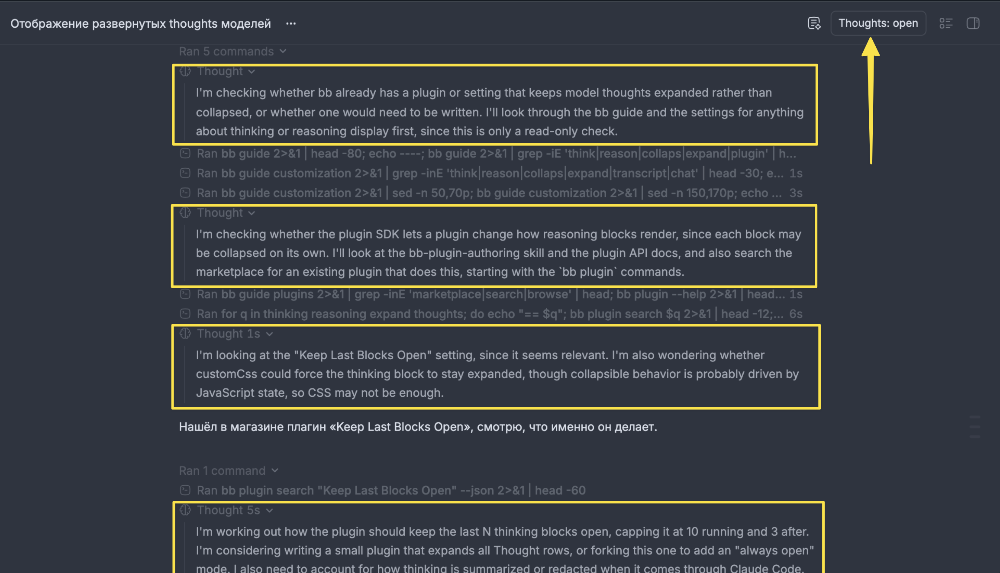

# Thoughts Open

[](https://github.com/smixs/bb-plugin-thoughts-open/actions/workflows/ci.yml)
[](LICENSE)

A [bb](https://getbb.app) plugin. Read what your agents are thinking and where they are heading, so you can stop them in time and steer them right.

Every Thought from every agent stays expanded and in full, right in the timeline. One button in the thread header folds them all again.



## What it does

- **One button flips it.** The thread header shows **Thoughts: open** or **Thoughts: folded**. Click it to switch every Thought in every thread at once. The command palette has the same switch: **Thoughts: show or fold**. The choice is saved on your bb server, so all your windows and devices follow it.
- **Every Thought row opens.** Claude Code, Codex, Pi, Cursor, Grok: any provider whose reasoning bb shows as a Thought row. Rows open as they stream in and stay open after the turn ends.
- **Thoughts inside groups are shown too.** bb folds finished thoughts into work groups such as "Ran 5 commands". A group that holds a Thought opens. A group of commands only stays folded.
- **Long thoughts are not cut.** bb caps the Thought body at 20rem with an inner scroll bar. The plugin lifts the cap, so the whole text sits in the timeline.
- **Folded means folded.** In folded mode open Thought rows fold, and groups that hold a Thought fold too.
- **Your clicks win.** Toggle one Thought or group by hand and the plugin leaves it as you set it, until you flip the header button again.

It needs no account or external service.

## Install

From the store: open **Plugins** in bb, search for **Thoughts Open**, and install it. Or from the command line:

```sh
bb plugin install thoughts-open
```

Straight from this repository:

```sh
bb plugin install https://github.com/smixs/bb-plugin-thoughts-open.git
```

Turn it off with `bb plugin disable thoughts-open`.

Requires bb 0.50 or later.

## How it works

The plugin has three parts:

- a content script ([`thoughts-open.ts`](thoughts-open.ts)) that opens or folds rows in the timeline;
- a thread header action and a command palette command ([`app.tsx`](app.tsx)) that flip the mode;
- a backend ([`server.ts`](server.ts)) that keeps the mode in the plugin's key-value storage and broadcasts each change on a realtime channel.

In open mode the content script works like this:

1. A `MutationObserver` watches the app and batches its passes into animation frames.
2. A timeline row whose id holds `op:reasoning` is a Thought. If its own `aria-expanded` toggle is closed, the plugin clicks it.
3. A row whose id holds `work-summary` is a group. A closed group hides its rows, so the plugin opens it once and looks inside. It keeps the group open when a Thought is there and closes it again otherwise. When the group header text changes (new rows joined), it looks again.
4. The Thought body gets a `data-thoughts-open-body` attribute, and one stylesheet removes its `max-height`.
5. A trusted click on a row's own toggle marks that row as yours. The plugin leaves it until the mode changes.

In folded mode it folds open Thought rows and open groups that hold a Thought. Each mode change hands every row back to the plugin.

A row the host folds back three times in a row is left alone, so the plugin cannot fall into a click loop with bb. Disabling the plugin removes its stylesheet, attributes, observer and listener.

## Limits

- The plugin reads bb's timeline markup: `data-timeline-row-id`, the `op:reasoning` and `work-summary` row ids, `aria-expanded` toggles and the `max-h-80` body class. A bb update that renames them stops the plugin without an error. Open an issue if that happens.
- A group without a Thought opens for one frame before it closes again.
- The plugin shows what the provider sends. A provider that sends only a summary of its reasoning shows that summary.

## Development

```sh
npm install
npm run check   # TypeScript and the vitest suite (happy-dom)
bb plugin build # compiles dist/ for bb
bb plugin install .
```

`bb plugin dev` rebuilds and reloads the plugin on every change.

## License

[MIT](LICENSE)
